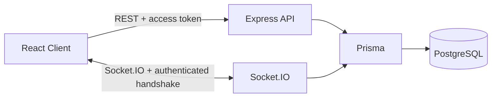

# Architecture

Nexus Chat is a single-repository full-stack application. React/Vite powers the browser UI, while Express and Socket.IO share one Node.js HTTP server. PostgreSQL stores users, conversations, participants, messages and refresh-token records through Prisma.

## Authentication

1. Registration or login verifies credentials on the HTTP API.
2. The server returns a short-lived access token and places a rotating opaque refresh token in an HttpOnly cookie.
3. The frontend keeps the access token in memory rather than localStorage.
4. Socket.IO sends the access token in the connection handshake.
5. Socket middleware verifies the token and derives the user ID from the signed token.

## Authorization

Authentication proves who the user is. Authorization determines what that user may access. Every private conversation join and every sent message checks database membership server-side. Client-provided sender IDs are never accepted.

## Presence

The in-memory `PresenceManager` stores a set of socket IDs for each user. A user becomes offline only after their final socket disconnects. This correctly handles multiple tabs on a single backend instance.

For horizontal scaling, replace in-memory presence with Redis and use the Socket.IO Redis adapter.
