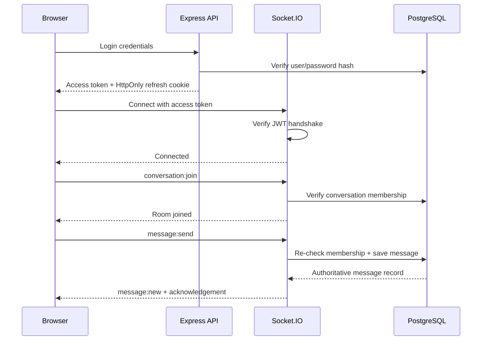

# Real-Time Pipeline

## Important events

- `conversation:join` — validates membership before joining `conversation:<id>`.
- `conversation:leave` — leaves the active real-time room.
- `message:send` — validates content, checks authorization, persists, then emits.
- `message:new` — carries the database-confirmed message.
- `typing:start` / `typing:stop` — ephemeral room events; never stored.
- `presence:online` / `presence:offline` — update contact status.
- `conversation:updated` — refreshes conversation previews after new messages.

The sender supplies only the conversation, content and a client message ID. The server derives sender identity from the authenticated socket.
